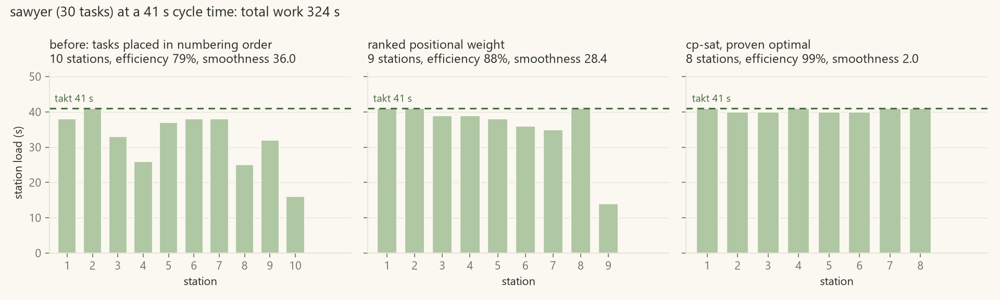
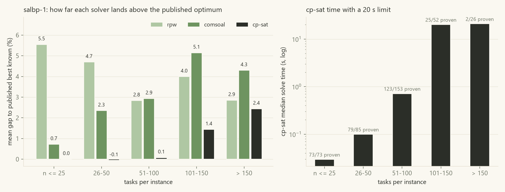
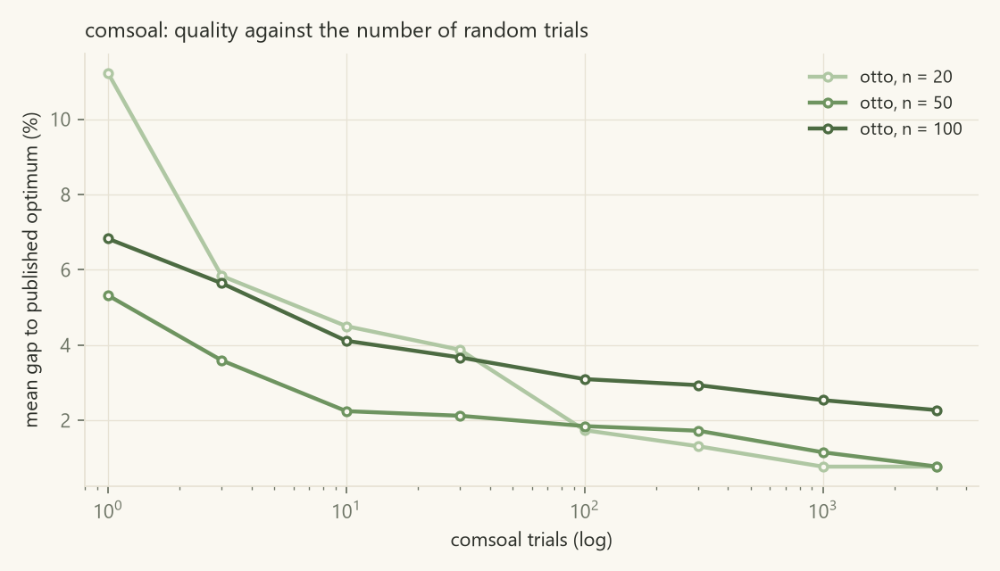
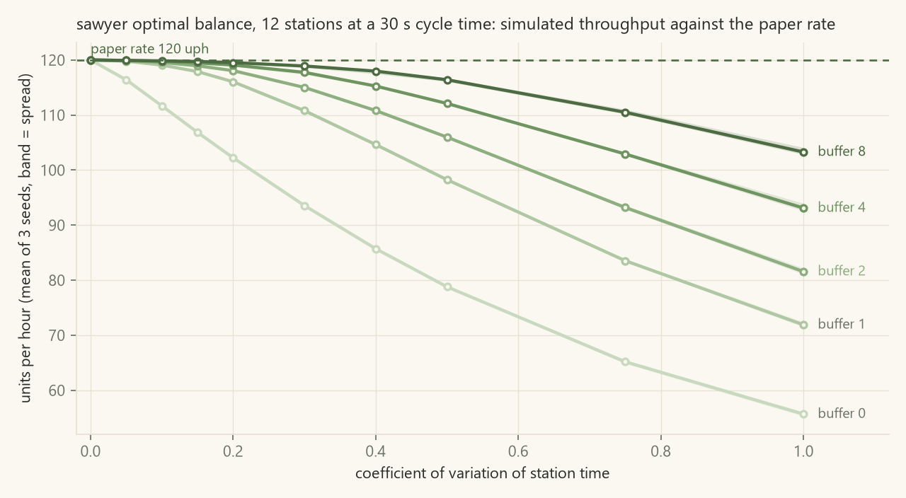

# ladder

a fish ladder is a row of stepped pools. water and fish move up one pool at a time, and the
slowest pool caps the rate of the whole thing. an assembly line works the same way: tasks are
grouped into stations, a unit moves one station per cycle, and the fullest station sets the takt.

this repo is three things. a solver for the simple assembly line balancing problem (two
heuristics and an exact cp-sat model) benchmarked against published optima, a discrete event
simulator that shows how much of a paper balance survives contact with variable station times
and finite buffers, and a small experiment on whether a language model can rebalance a line
from a plain language change request. every number below comes from a run whose json is
committed next to it in `results/`.



the chart is sawyer's 30 task instance at a 41 s cycle time. left: tasks dropped into stations
in numbering order, which is roughly what a line looks like before anyone balances it. middle:
ranked positional weight. right: the cp-sat solution, proven optimal. the numbers behind it are
in `results/win11-20261104/station_loading.json`.

## the problem

simple assembly line balancing (salbp): tasks with fixed durations and precedence constraints,
assigned to stations on a paced line, every task in exactly one station, no task before any of
its predecessors, no station loaded past the cycle time.

- **salbp-1**: the cycle time is given, minimise the number of stations.
- **salbp-2**: the number of stations is given, minimise the cycle time.

both are np-hard. all three solvers here do both.

## the data

no invented instances. `tools/fetch_data.py` downloads two archives from
[assembly-line-balancing.de](https://assembly-line-balancing.de/salbp/) and records their
sha256 in `data/manifest.json`; the raw files are gitignored.

- **otto, otto and scholl (2013)**: 525 generated instances each at n = 20, 50 and 100 tasks,
  all at a cycle time of 1000. the spreadsheets that ship inside the archive give the optimal
  station count, or a [lower, upper] range for instances that are still open.
- **scholl (1993)**: the 25 classic precedence graphs (mertens, bowman, jaeschke, ... sawyer,
  ... arcus, barthold, scholl) with the published salbp-1 table (269 graph and cycle time
  pairs, one still open) and salbp-2 table (302 graph and station count pairs, 14 open).

`data/optima/*.json` is the published optimum tables pulled out of those spreadsheets. the
benchmark runs the whole scholl salbp-1 set, the first scholl salbp-2 set (128 instances, 30 to
111 tasks), and a seeded sample of 40 otto instances per size.

## the solvers

- `ladder/solvers/rpw.py`: ranked positional weight (helgeson and birnie). a task's weight is its
  own time plus everything downstream of it; stations are filled greedily in weight order.
- `ladder/solvers/comsoal.py`: comsoal (arcus). each trial builds a line by picking uniformly at
  random among the tasks that are ready and still fit; n trials, keep the best.
- `ladder/solvers/exact.py`: or-tools cp-sat. binary task-to-station variables restricted to
  each task's earliest and latest feasible station, a station-open variable per station for
  salbp-1 or an integer cycle time for salbp-2, the rpw solution passed in as a hint.
  `proven` is true only when cp-sat reports optimal inside the time limit.

the heuristics solve salbp-2 by searching the cycle time: a bisection on [lower bound, sum of
task times] and then a downward sweep, since neither heuristic is monotone in the cycle time.

`ladder/validate.py` checks every solution for precedence and cycle time before any number is
recorded. a failed check raises and nothing catches it, so `run.sh` exits non-zero.

## benchmark

<!-- TABLE: benchmark -->
environment: 13th Gen Intel(R) Core(TM) i7-1355U, 12 logical cpus, Windows 11, python 3.13.12, or-tools 9.15.6755, simpy 4.1.2. heuristics timed as the median of 3 runs, cp-sat run 1 time with 8 workers and a 20 s limit, comsoal 500 trials, otto sample 40 per size (seed 0).

**scholl-salbp1** (salbp-1, 269 instances, 7 to 297 tasks, 1 with no proven optimum, gap taken to the best known value)

| solver | mean gap | median gap | max gap | matched published optimum | time median | time max | mean efficiency | mean smoothness |
|---|---|---|---|---|---|---|---|---|
| rpw | 3.89% | 0.00% | 50.0% | 135/268 | 1 ms | 32 ms | 89.5% | 719.2 |
| comsoal | 3.00% | 0.00% | 20.0% | 138/268 | 109 ms | 952 ms | 90.1% | 505.8 |
| cp-sat | 0.56% | 0.00% | 7.7% | 217/268 (200 proven) | 568 ms | 124.3 s | 92.3% | 557.9 |

**scholl-salbp2** (salbp-2, 128 instances, 29 to 111 tasks, 9 with no proven optimum, gap taken to the best known value)

| solver | mean gap | median gap | max gap | matched published optimum | time median | time max | mean efficiency | mean smoothness |
|---|---|---|---|---|---|---|---|---|
| rpw | 2.83% | 2.35% | 12.5% | 10/119 | 13 ms | 30 ms | 95.1% | 355.7 |
| comsoal | 2.04% | 1.86% | 6.8% | 30/119 | 362 ms | 1.6 s | 95.8% | 534.0 |
| cp-sat | 0.03% | 0.00% | 1.0% | 100/119 (97 proven) | 362 ms | 20.4 s | 97.6% | 167.5 |

**otto-n20** (salbp-1, 40 instances, 20 to 20 tasks, 1 with no proven optimum, gap taken to the best known value)

| solver | mean gap | median gap | max gap | matched published optimum | time median | time max | mean efficiency | mean smoothness |
|---|---|---|---|---|---|---|---|---|
| rpw | 5.26% | 0.00% | 33.3% | 27/39 | 0 ms | 0 ms | 87.0% | 525.1 |
| comsoal | 1.00% | 0.00% | 20.0% | 36/39 | 0 ms | 25 ms | 90.2% | 325.5 |
| cp-sat | 0.00% | 0.00% | 0.0% | 39/39 (40 proven) | 24 ms | 118 ms | 91.1% | 343.0 |

**otto-n50** (salbp-1, 40 instances, 50 to 50 tasks, 12 with no proven optimum, gap taken to the best known value)

| solver | mean gap | median gap | max gap | matched published optimum | time median | time max | mean efficiency | mean smoothness |
|---|---|---|---|---|---|---|---|---|
| rpw | 3.14% | 0.00% | 14.3% | 20/28 | 0 ms | 1 ms | 87.8% | 836.2 |
| comsoal | 1.90% | 0.00% | 9.1% | 23/28 | 29 ms | 68 ms | 88.8% | 638.1 |
| cp-sat | -0.12% | 0.00% | 9.1% | 27/28 (34 proven) | 96 ms | 20.3 s | 90.5% | 644.3 |

**otto-n100** (salbp-1, 40 instances, 100 to 100 tasks, 13 with no proven optimum, gap taken to the best known value)

| solver | mean gap | median gap | max gap | matched published optimum | time median | time max | mean efficiency | mean smoothness |
|---|---|---|---|---|---|---|---|---|
| rpw | 3.42% | 3.31% | 10.7% | 15/27 | 1 ms | 3 ms | 91.3% | 886.7 |
| comsoal | 3.88% | 4.46% | 11.5% | 15/27 | 80 ms | 125 ms | 90.9% | 773.7 |
| cp-sat | -0.04% | 0.00% | 4.8% | 25/27 (28 proven) | 430 ms | 21.6 s | 94.3% | 579.3 |

**cp-sat time to prove optimality by instance size (salbp-1, all sets pooled)**

| tasks | instances | proven within limit | median time (proven) | max time (proven) | mean gap when not proven |
|---|---|---|---|---|---|
| <= 25 | 73 | 73 | 29 ms | 179 ms | - |
| 26-50 | 85 | 79 | 90 ms | 18.8 s | 0.92% |
| 51-100 | 153 | 123 | 508 ms | 17.7 s | 0.46% |
| 101-150 | 52 | 25 | 293 ms | 18.5 s | 2.76% |
| > 150 | 26 | 2 | 14.8 s | 16.5 s | 2.64% |

**solutions below the published best known value** (all on instances whose optimum is still open; every one passed the validator)

| set | instance | solver | value found | published [lb, ub] | proven optimal here |
|---|---|---|---|---|---|
| scholl-salbp2 | Arcus2_m25 | cp-sat | 6097 | [6085, 6101] | False |
| otto-n50 | instance_n=50_104 | cp-sat | 27 | [25, 28] | True |
| otto-n50 | instance_n=50_267 | cp-sat | 28 | [27, 29] | True |
| otto-n50 | instance_n=50_339 | cp-sat | 27 | [27, 28] | False |
| otto-n50 | instance_n=50_415 | cp-sat | 28 | [26, 29] | True |
| otto-n100 | instance_n=100_210 | cp-sat | 52 | [51, 53] | False |
| otto-n100 | instance_n=100_289 | cp-sat | 62 | [61, 65] | False |
| otto-n100 | instance_n=100_367 | cp-sat | 56 | [55, 57] | False |
| otto-n100 | instance_n=100_431 | cp-sat | 54 | [52, 55] | False |
| otto-n100 | instance_n=100_445 | cp-sat | 56 | [54, 57] | False |
| otto-n100 | instance_n=100_506 | cp-sat | 57 | [54, 58] | True |

whole benchmark run: 57 min wall clock.
<!-- /TABLE -->



<!-- TABLE: comsoal -->
**comsoal: mean gap to the published optimum against trials**

| set | instances | n=1 | n=3 | n=10 | n=30 | n=100 | n=300 | n=1000 | n=3000 |
|---|---|---|---|---|---|---|---|---|---|
| otto-n20 | 39 | 11.23% (17 opt) | 5.84% (23 opt) | 4.50% (25 opt) | 3.87% (28 opt) | 1.74% (33 opt) | 1.31% (35 opt) | 0.77% (37 opt) | 0.77% (37 opt) |
| otto-n50 | 28 | 5.32% (15 opt) | 3.59% (19 opt) | 2.24% (20 opt) | 2.12% (20 opt) | 1.85% (21 opt) | 1.72% (22 opt) | 1.15% (24 opt) | 0.77% (25 opt) |
| otto-n100 | 27 | 6.83% (2 opt) | 5.64% (3 opt) | 4.11% (8 opt) | 3.67% (10 opt) | 3.10% (13 opt) | 2.93% (14 opt) | 2.54% (16 opt) | 2.27% (17 opt) |
<!-- /TABLE -->



what the tables say:

- **rpw is a one millisecond heuristic that lands within 3 to 5% of optimal on average**, and
  hits the optimum outright on half the scholl salbp-1 instances. the 50% max gap is a seven
  task instance where one extra station is half the optimum. for a first cut on a line it is
  hard to argue with.
- **comsoal beats rpw on small instances and loses to it on large ones.** at 20 tasks 500
  random trials get within 1% and match 36 of 39 optima; at 100 tasks it is worse than rpw
  (3.9% against 3.4%). uniform random construction does not scale, and the trials sweep shows
  it: going from 300 to 3000 trials buys a lot at n = 20 and much less at n = 100.
- **cp-sat proves every instance up to 25 tasks in well under a second** and most up to 100
  tasks inside 20 s. above 150 tasks it proved 2 of 26, but even where it timed out its
  solution was still better than either heuristic (2.4% mean gap against 2.9% and 4.3%). the
  time to prove grows by roughly an order of magnitude per size bucket.
- **it found solutions below the published upper bound on eleven open instances** and proved
  four of them optimal. i did not expect that. the bounds in the 2013 spreadsheets came from
  salome with 20 to 70 s limits on 2013 hardware, and the literature has moved since (morrison
  et al. 2014 closed many of these), so this says more about or-tools in 2026 than about the
  instances. every one of those solutions went through the validator like the rest.
- **salbp-2 is where the heuristics look worst on the "matched optimum" column** (rpw 10 of
  119) because hitting the exact minimum cycle time is a much finer target than hitting a
  station count; the mean gap is still under 3%.
- one cp-sat run (barthol2 at c = 85, 148 tasks) took 124 s against a 20 s limit. the limit is
  on cp-sat's search; i could not reproduce the overshoot on its own and have left the number
  as measured.

## simulator

a balance is balanced on paper. `ladder/sim.py` (simpy) runs the line with station times drawn
lognormally around each station's nominal load, a coefficient of variation you choose, a finite
buffer of a chosen size between neighbouring stations, and the two things that cost throughput
on a real line: blocking (the next buffer is full) and starving (the previous one is empty). the
first station never starves and the last never blocks. buffer 0 means a direct hand-off: the
upstream station holds its finished unit until the downstream station is free.

each run discards a warm-up and then measures units per hour (treating task times as seconds),
units per person-hour at one operator per station, per-station utilization, and the share of
time each station spends blocked or starved. the "paper rate" is 3600 / cycle time, the rate
the balance promises.

the oee-style figure is honest about what is and is not modelled: availability is set to 1.0
because there are no breakdowns or changeovers in the model, quality is set to 1.0 because
there are no defects or rework, and performance is simulated throughput over the paper rate.
so oee here is just the performance term. the assumptions are written into the json next to
the number.



<!-- TABLE: sim -->
simulation: 5000 units measured after a 500 unit warm-up, 3 seeds per cell.

**Sawyer_c30**: 12 stations, cycle time 30, paper rate 120.0 uph, line efficiency 90.0%. cells are simulated throughput as a share of the paper rate (mean, min-max over seeds).

| cv | buffer 0 | buffer 1 | buffer 2 | buffer 4 | buffer 8 |
|---|---|---|---|---|---|
| 0.0 | 100.0% (100.0-100.0) | 100.0% (100.0-100.0) | 100.0% (100.0-100.0) | 100.0% (100.0-100.0) | 100.0% (100.0-100.0) |
| 0.05 | 97.0% (97.0-97.0) | 99.8% (99.8-99.8) | 99.9% (99.9-99.9) | 99.9% (99.9-100.0) | 99.9% (99.9-100.0) |
| 0.1 | 93.1% (93.0-93.1) | 99.2% (99.1-99.3) | 99.6% (99.5-99.7) | 99.8% (99.8-99.8) | 99.9% (99.8-99.9) |
| 0.15 | 89.0% (89.0-89.1) | 98.2% (98.2-98.3) | 99.1% (98.9-99.2) | 99.6% (99.5-99.6) | 99.8% (99.7-99.8) |
| 0.2 | 85.2% (85.1-85.3) | 96.7% (96.6-96.7) | 98.4% (98.2-98.5) | 99.2% (99.0-99.4) | 99.6% (99.6-99.7) |
| 0.3 | 78.0% (77.9-78.1) | 92.3% (92.2-92.4) | 95.8% (95.8-95.9) | 98.1% (97.8-98.3) | 99.1% (98.8-99.3) |
| 0.4 | 71.4% (71.3-71.6) | 87.2% (87.0-87.3) | 92.3% (92.2-92.4) | 96.0% (95.9-96.3) | 98.3% (97.9-98.5) |
| 0.5 | 65.7% (65.5-65.9) | 81.9% (81.7-82.0) | 88.3% (88.2-88.4) | 93.4% (93.3-93.6) | 97.0% (96.7-97.3) |
| 0.75 | 54.3% (54.1-54.6) | 69.6% (69.5-69.9) | 77.7% (77.4-78.0) | 85.8% (85.5-86.0) | 92.1% (91.8-92.5) |
| 1.0 | 46.4% (46.0-46.8) | 59.9% (59.5-60.4) | 68.0% (67.6-68.5) | 77.6% (77.2-78.3) | 86.1% (85.7-86.7) |

reference point cv=0.3, buffer=1, seed 1: actual 110.6 uph vs paper 120.0 (bottleneck rate 120.0), upph 9.22 vs 10.00 paper, mean utilization 82.9%, oee 92.2% (availability 1.0, performance 92.2%, quality 1.0).

| station | load | utilization | starved | blocked |
|---|---|---|---|---|
| 1 | 30 | 92.0% | 0.0% | 8.0% |
| 2 | 30 | 92.5% | 3.7% | 3.7% |
| 3 | 28 | 85.6% | 8.8% | 5.6% |
| 4 | 29 | 88.9% | 8.2% | 2.9% |
| 5 | 29 | 89.0% | 10.9% | 0.1% |
| 6 | 21 | 64.5% | 34.4% | 1.2% |
| 7 | 24 | 73.5% | 23.4% | 3.1% |
| 8 | 27 | 83.1% | 15.0% | 1.9% |
| 9 | 26 | 79.5% | 17.8% | 2.6% |
| 10 | 25 | 77.2% | 18.2% | 4.6% |
| 11 | 25 | 77.1% | 14.7% | 8.1% |
| 12 | 30 | 92.2% | 7.8% | 0.0% |

**instance_n=50_1_c1000**: 8 stations, cycle time 1000, paper rate 3.6 uph, line efficiency 91.0%. cells are simulated throughput as a share of the paper rate (mean, min-max over seeds).

| cv | buffer 0 | buffer 1 | buffer 2 | buffer 4 | buffer 8 |
|---|---|---|---|---|---|
| 0.0 | 100.9% (100.9-100.9) | 100.9% (100.9-100.9) | 100.9% (100.9-100.9) | 100.9% (100.9-100.9) | 100.9% (100.9-100.9) |
| 0.05 | 96.9% (96.8-96.9) | 100.8% (100.7-100.8) | 100.8% (100.8-100.9) | 100.8% (100.8-100.9) | 100.8% (100.8-100.9) |
| 0.1 | 92.0% (92.0-92.0) | 100.0% (100.0-100.1) | 100.5% (100.5-100.6) | 100.7% (100.6-100.8) | 100.7% (100.6-100.8) |
| 0.15 | 87.5% (87.5-87.5) | 98.5% (98.4-98.5) | 99.8% (99.8-99.9) | 100.5% (100.4-100.5) | 100.6% (100.4-100.7) |
| 0.2 | 83.3% (83.3-83.3) | 96.3% (96.2-96.4) | 98.6% (98.5-98.7) | 99.9% (99.9-99.9) | 100.4% (100.3-100.6) |
| 0.3 | 75.9% (75.9-75.9) | 91.1% (91.0-91.2) | 95.2% (95.1-95.4) | 98.1% (97.9-98.1) | 99.6% (99.5-99.7) |
| 0.4 | 69.5% (69.5-69.6) | 85.5% (85.4-85.7) | 91.1% (90.9-91.3) | 95.5% (95.2-95.7) | 98.1% (98.1-98.3) |
| 0.5 | 64.1% (64.1-64.2) | 80.0% (79.8-80.3) | 86.6% (86.4-86.9) | 92.4% (92.2-92.8) | 96.3% (96.1-96.5) |
| 0.75 | 53.9% (53.8-54.0) | 68.2% (67.9-68.5) | 76.0% (75.7-76.4) | 84.0% (83.5-84.6) | 90.6% (89.9-91.2) |
| 1.0 | 46.9% (46.7-47.1) | 59.3% (59.0-59.7) | 67.0% (66.6-67.6) | 75.8% (75.2-76.6) | 84.2% (83.4-85.0) |

reference point cv=0.3, buffer=1, seed 1: actual 3.3 uph vs paper 3.6 (bottleneck rate 3.6), upph 0.41 vs 0.45 paper, mean utilization 82.7%, oee 91.1% (availability 1.0, performance 91.1%, quality 1.0).

| station | load | utilization | starved | blocked |
|---|---|---|---|---|
| 1 | 987 | 89.7% | 0.0% | 10.3% |
| 2 | 958 | 87.6% | 2.7% | 9.7% |
| 3 | 991 | 89.8% | 3.3% | 6.9% |
| 4 | 963 | 87.5% | 5.7% | 6.8% |
| 5 | 991 | 90.2% | 5.7% | 4.1% |
| 6 | 971 | 88.3% | 8.8% | 2.9% |
| 7 | 987 | 89.6% | 10.4% | 0.0% |
| 8 | 428 | 39.1% | 60.9% | 0.0% |
<!-- /TABLE -->

what the sweep says:

- **the finding: with no buffers, a cv of 0.3 costs 22% of the paper rate, and a cv of 1.0
  costs more than half.** a balance that is optimal on paper is only a ceiling. station time
  variability of 0.3 is not exotic for manual work.
- **one buffer slot between stations recovers most of it** (78% to 92% at cv 0.3), eight slots
  recover nearly all of it (99%). buffers are what let a paced line survive variability, and the
  returns diminish fast.
- **the curve barely depends on the instance.** the 50 task otto line with 8 stations loses
  almost exactly what the 30 task sawyer line with 12 stations loses at every cell. the loss is
  a property of cv and buffer size, not of the particular balance.
- **the lightly loaded station starves.** in the per-station table, station 6 (21 s of a 30 s
  takt) is starved a third of the time; stations at the front of the line block, stations at the
  back starve, exactly as the metaphor says.
- the otto line reads 100.9% at cv 0 because its busiest station carries 991 s against a 1000 s
  takt, so the unpaced line runs at the bottleneck rate, slightly above the paper rate. the
  sawyer line has a station at exactly 30 s, so it reads 100.0%.
- i could not measure real downtime or defect rates, so the oee figure is only the performance
  term, stated as such.

## agent (experimental)

`ladder/agent/` gives a language model the line as it is today (task table, current station
assignment, cycle time) and one change in plain language, for example "station 4 is the
bottleneck, we are adding a second screw-fastening fixture for task 23, so task 23 drops from
7.8 to 4.2". the model has to apply the change itself and answer with a station assignment as
json. the validator decides whether the answer is usable, cp-sat (proven optimal on the changed
instance) decides how good it is, and rpw on the same changed instance is the bar to beat.

36 fixed scenarios, generated once with a seed and committed in `ladder/agent/scenarios.json`:
nine scholl graphs (21 to 53 tasks) at a published cycle time, each with four kinds of change
(a task gets faster, a task gets slower, the takt moves, a new precedence constraint). one
attempt per scenario, temperature 0, no retries on a bad answer (only on transport errors). the
models are cohere's command family because that is the api key i had.

<!-- TABLE: agent -->
| model | feasible | mean gap when feasible | matched optimum | beats rpw | ties rpw | loses to rpw | failure modes | mean latency |
|---|---|---|---|---|---|---|---|---|
| command-a-03-2025 | 2/36 | 10.0% | 1/2 | 0 | 1 | 1 | cycle_time_exceeded 12, missing_tasks 11, precedence_and_cycle_time 8, precedence_violation 3 | 6 s |
| command-a-plus-05-2026 | 22/36 | 0.5% | 21/22 | 4 | 18 | 0 | no_json 13, cycle_time_exceeded 1 | 93 s |

command-a-03-2025 feasibility by change type: fixture 1/9, added_step 0/9, takt 1/9, precedence 0/9; rpw was beatable (rpw > optimum) in 9 scenarios.
command-a-plus-05-2026 feasibility by change type: fixture 6/9, added_step 8/9, takt 5/9, precedence 3/9; rpw was beatable (rpw > optimum) in 9 scenarios.
<!-- /TABLE -->

<!-- NOTES: agent -->
what the agent run says:

- **command-a-plus-05-2026 (a reasoning model) returned a usable balance on 22 of 36
  scenarios.** when it did answer, the answer was very good: 21 of 22 matched the cp-sat
  optimum, it beat rpw on 4 of the 9 scenarios where rpw was beatable and never lost to it.
- **the dominant failure mode is not a wrong answer, it is no answer.** all 13 `no_json`
  failures are the model hitting the 32000 output token limit while still reasoning (100k+
  characters of thinking) and never emitting the json. the per-scenario json records the
  finish reason and token counts. each of those calls took two to three minutes.
- **the one infeasible answer overloaded a station** (36 s on a 26 s takt after a task grew
  from 5 to 7 s), so applying the change in prose to the arithmetic is where it slipped.
- **new precedence constraints were the hardest change** (3 of 9 feasible) and a slower task
  the easiest (8 of 9). a changed takt sat in between (5 of 9).
- **command-a-03-2025 (no reasoning) answered in six seconds and was almost never right: 2 of
  36 feasible.** it answered instantly with about 150 tokens and the answers broke the cycle
  time on 20 scenarios, dropped tasks on 11, and put a task ahead of its predecessor on 11
  (some answers did two of these at once). it never beat rpw. this is the asserted-positive
  trap: the output looks like a balance and reads confidently, and without the validator it
  would have been reported as one.
- a line engineer could use the feasible answers as they are, but could not rely on getting
  one, and would wait minutes for it. rpw answers in a millisecond and is always feasible.
<!-- /NOTES -->

## where it falls short

- **no changeovers, no mixed models.** one product, one takt. real lines run several variants
  and sequence them; that is a different problem (mixed model balancing and sequencing).
- **no operator learning, no fatigue, no cross-training.** station times are stationary draws.
  on a real line the same operator gets faster over weeks and slower across a shift.
- **no rework loops, no scrap, no downtime.** units never leave the line and never come back,
  stations never break. the oee figure is therefore only its performance term.
- **lognormal with one cv for every station** is a modelling choice, not a measurement. real
  stations have different variability, and manual stations are usually worse than automated
  ones.
- **task times are deterministic integers from the benchmark files.** the benchmark says
  nothing about whether a real balance holds up; that is what the simulator is for, and the
  simulator is only as good as the distributions above.
- **the exact solver is time limited.** anything it did not prove is reported as not proven;
  on the large scholl graphs and the "extremely tricky" otto instances that is most of them.
- **the agent experiment is one prompt format, one attempt, two models from one vendor.** it
  measures what those models do with that prompt, not what language models can do.
- **salbp ignores everything spatial.** no station lengths, no tooling conflicts, no zoning
  constraints, no two-sided lines.

## reproduce

```
pip install -r requirements.txt
bash run.sh <label>
```

that fetches the data, runs the tests, the benchmark, the comsoal sweep, the simulation sweep,
the agent runs (if `COHERE_API_KEY` is set, otherwise they are skipped) and the charts, into
`results/<label>/`. it exits non-zero if any solution fails validation. the tables in this file
are pasted from `python bench/tables.py --label <label>` by `tools/fill_readme.py`.
